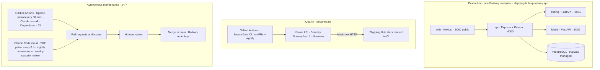

# Bruno Carbone · projects

A production full-stack platform, the black-box QA suite that tests it, a TikTok short-drama downloader for personal offline viewing, and a portfolio site — maintained around the clock by Claude Code agents.

[](https://github.com/brunocarbone98/projects/actions/workflows/ci.yml)
[](https://github.com/brunocarbone98/projects/actions/workflows/securegate-ci.yml)
[](https://github.com/brunocarbone98/projects/actions/workflows/uptime-patrol.yml)
[](https://github.com/brunocarbone98/projects/actions/workflows/claude.yml)
[](https://shipping-hub.up.railway.app/)
[](./OPERATIONS.md)

**Shipping Hub** is a bilingual (es/en) parcel shipping & tracking platform deployed live on Railway. **SecureGate** is the QA & security suite that tests it black-box — Karate API, Serenity Screenplay UI, Postman/Newman — in CI. **PersonalWebsite** is the portfolio that presents both. **DramaFetch** is a Python CLI and local web UI that downloads the TikTok short-drama episodes your own account can already watch — whole series, several in one run — for personal offline viewing: paid episodes your account has unlocked download like free ones, and it never unlocks, buys or decrypts anything. All four are maintained around the clock by Claude Code agents: CI on every push to `main` and every pull request, nightly QA regression, an uptime patrol every 30 minutes, dependency updates, nightly maintenance PRs, a weekly security review, and an on-call agent you can `@claude` in any issue or PR. Agents open pull requests and issues; a human reviews and merges.

## What's inside

| Project | What it is | Stack | Links |
| --- | --- | --- | --- |
| [`FullStackHub/`](./FullStackHub) — **Shipping Hub** | International parcel shipping & tracking platform: public SSR tracking, quotes, customer/staff dashboards, a wallet backed by a double-entry ledger | Next.js 16 · Express 5 + Prisma · PostgreSQL · FastAPI ×2 · Zod contracts · pnpm 10 + Turborepo | [Live app](https://shipping-hub.up.railway.app/) · [README](./FullStackHub/README.md) · [](https://github.com/brunocarbone98/projects/actions/workflows/ci.yml) |
| [`SecureGate/`](./SecureGate) — **QA & security suite** | Black-box tests for Shipping Hub: 28 Karate API scenarios (+1 opt-in `@ratelimit` check), 6 Serenity/Screenplay UI scenarios, a Postman/Newman collection, a token-gated SonarQube gate | Java 21 · Maven · Karate · Serenity BDD + Screenplay · Selenium · Cucumber · Newman | [README](./SecureGate/README.md) · [](https://github.com/brunocarbone98/projects/actions/workflows/securegate-ci.yml) |
| [`DramaFetch/`](./DramaFetch) — **TikTok short-drama downloader** | Downloads the episodes of a TikTok short drama that your own account can already watch — whole series, in batches — for personal offline viewing: CLI + local web UI with a save-all ZIP, resumable manifest, covers embedded, paced against TikTok's anti-bot limits; paid episodes your account unlocked included, the rest listed and skipped — never unlocked, DRM never decrypted | Python 3.11 · yt-dlp · Playwright · mutagen · stdlib web UI | [README](./DramaFetch/README.md) · [](https://github.com/brunocarbone98/projects/actions/workflows/ci.yml) |
| [`PersonalWebsite/`](./PersonalWebsite) | Static two-page portfolio served by GitHub Pages | Vanilla HTML/CSS/JS, no dependencies | [`MainPage.html`](./PersonalWebsite/MainPage.html) · [`Portfolio.html`](./PersonalWebsite/Portfolio.html) |

## Architecture



## Autonomous maintenance

The repository is maintained around the clock by Claude Code agents on two runtimes: **GitHub Actions** for anything that must reach the live app, a browser or a GitHub event, and **Claude Code cloud scheduled tasks** for the agent shifts — each a standing session resumed on a schedule, whose prompt is a Markdown file in [`.claude/shifts/`](./.claude/shifts), reviewed like code.

| Shift | Cadence | Runtime | What it does | Output |
| --- | --- | --- | --- | --- |
| CI | every push to `main`, every PR | GitHub Actions · `ci.yml` | Lint, format check, typecheck, Vitest (shared + API against PostgreSQL); DramaFetch `ruff`, `mypy`, `pytest` and the Chromium integration test | Green/red check |
| SecureGate CI | PRs touching `SecureGate/` or `FullStackHub/`; nightly 06:00 UTC | GitHub Actions · `securegate-ci.yml` | Starts Postgres + API + web + Chrome; runs Karate API + Serenity UI + Newman | `securegate-reports` artifact (Serenity, Karate, surefire) |
| Uptime patrol | every 30 min (best-effort GitHub schedule) + manual | GitHub Actions · `uptime-patrol.yml` | Probes `/en`, the demo tracking page, `/es/quote` and `/sitemap.xml` on the live app | Opens, updates and auto-closes `🚨 Production incident: Shipping Hub is unhealthy` (label `incident`) |
| Claude on-call | on `@claude` in an issue, PR comment or review | GitHub Actions · `claude.yml` | Reads the request, works on a branch, answers in a comment | Comments; `claude/…` branches with a ready-to-open PR link |
| Dependabot | npm, pip and Maven weekly, Mondays 04:00 America/Panama (grouped minor/patch, at most 5 open PRs per ecosystem); GitHub Actions monthly, grouped | GitHub · `dependabot.yml` | Grouped minor/patch bumps for npm, pip, Maven and Actions | PRs labelled `dependencies` |
| SRE patrol | every 6 h (`28 */6 * * *` UTC) | Claude Code cloud · `.claude/shifts/sre-patrol.md` | Reads the last 24 h of workflow runs and open incidents; diagnoses from logs | `fix(agents): …` PR when the cause is in-repo; one diagnosis comment on the incident issue when it is the hosting |
| Nightly maintenance | daily 08:40 UTC (`40 8 * * *`) | Claude Code cloud · `.claude/shifts/nightly-maintenance.md` | Runs every check and the Karate API suite against a local stack, reviews Dependabot PRs, fixes docs drift, picks at most one small improvement | `chore(agents): nightly maintenance <date>` PR or `🧪 Nightly maintenance failed: <date>` issue — nothing when nothing is needed |
| Weekly security review | Mondays 10:20 UTC (`20 10 * * 1`) | Claude Code cloud · `.claude/shifts/weekly-security-review.md` | `pnpm audit`, `pip-audit`, Maven updates, secret grep, auth/CORS/rate-limit/Dockerfile/workflow-permissions review | `chore(deps): weekly security bumps <date>` PR; `🔐 Weekly security review: <date>` issue for everything else |

**Guardrails** (the full eight rules are in [`AGENTS.md`](./AGENTS.md)):

- Agents never push to `main`, never force-push and never merge — a human merges every PR.
- One small PR per shift run; if nothing is needed, nothing is opened — no empty PRs, no "all good" issues.
- The project's own checks run before any PR and the real results are reported — a SecureGate run with 0 failures and N skipped is not a pass.
- No test is weakened, skipped or quarantined to get green, and each project's architectural rules are respected.
- Schema, money, auth, deploy-config and major-version decisions go to a human through an issue.

**How to watch it**

- [Actions tab](https://github.com/brunocarbone98/projects/actions) — every workflow run with its step summary (the Uptime patrol probe table lives there).
- [Pull requests `label:agent`](https://github.com/brunocarbone98/projects/pulls?q=is%3Apr+label%3Aagent) — what the agents proposed; [`label:dependencies`](https://github.com/brunocarbone98/projects/pulls?q=is%3Apr+label%3Adependencies) for Dependabot.
- Issues [`label:incident`](https://github.com/brunocarbone98/projects/issues?q=label%3Aincident) · [`label:security`](https://github.com/brunocarbone98/projects/issues?q=label%3Asecurity) · [`label:maintenance`](https://github.com/brunocarbone98/projects/issues?q=label%3Amaintenance).
- The scheduled-task sessions in [claude.ai/code](https://claude.ai/code) — every shift run is a session whose transcript you can open and read.

The operations manual — roster, shifts, runtimes, incident flow, FAQ — is [`OPERATIONS.md`](./OPERATIONS.md).

## Live demo

Shipping Hub runs at <https://shipping-hub.up.railway.app/>: track `PTY-2026-001001-0` without an account, get a quote, or sign in as `ana@example.com` / `Password123!` (customer) or `admin@shippinghub.test` / `Password123!` (admin) to see the dashboards and the wallet. A 12-minute interview runbook — what to show, in which order, and what to do if something breaks — is [`DEMO.md`](./DEMO.md).

## Quick start

Shipping Hub — web on :3000, API on :4000; needs Node 22, pnpm 10 and PostgreSQL:

```bash
cd FullStackHub && pnpm install
docker compose up -d                                   # PostgreSQL — or ../.claude/scripts/local-postgres.sh without Docker
pnpm --filter @shipping-hub/api db:deploy && pnpm --filter @shipping-hub/api db:seed
pnpm dev
```

SecureGate — black-box, so it needs the API on :4000; the UI profile also needs the web on :3000 and Chrome:

```bash
cd SecureGate
./mvnw verify                                          # 28 Karate API scenarios (skipped, not failed, when no stack is up)
./mvnw verify -Pui -Dheadless.mode=true                # + 6 Serenity/Screenplay UI scenarios
```

DramaFetch — Python 3.11+; episode discovery needs Playwright's Chromium (`playwright install chromium`) or an installed Chrome (`--browser-channel chrome`), and a `cookies.txt` exported from your logged-in browser:

```bash
cd DramaFetch && python -m venv .venv && . .venv/bin/activate && pip install -e ".[impersonate,dev]"
dramafetch doctor --cookies cookies.txt                 # Python, yt-dlp, curl_cffi, Playwright, browser, ffmpeg, cookies (names only, never values), mutagen, cooldown
dramafetch download "https://www.tiktok.com/shortdrama/episode/<series id>/1" --cookies cookies.txt
dramafetch download --from-file series.txt --cookies cookies.txt   # several series, one after the other, paced
```

Website — no build step, no dependencies:

```bash
open PersonalWebsite/MainPage.html                     # xdg-open on Linux
```

## Repository layout

```text
.
├── .claude/
│   ├── agents/              sre-patrol · repo-steward · qa-regression · security-auditor · docs-keeper
│   ├── shifts/              sre-patrol.md · nightly-maintenance.md · weekly-security-review.md
│   ├── scripts/             local-postgres.sh · local-api.sh · run-checks.sh
│   ├── hooks/               format-on-save.sh — Prettier on FullStackHub files after every edit
│   └── settings.example.json  pre-allowed commands + the PostToolUse hook — copy to settings.json and commit to enable
├── .github/
│   ├── workflows/           ci.yml · securegate-ci.yml · uptime-patrol.yml · claude.yml · labels.yml
│   ├── scripts/             uptime-probe.sh (the Uptime patrol probe, runnable locally)
│   ├── ISSUE_TEMPLATE/      agent-task.yml · bug-report.yml · config.yml
│   ├── dependabot.yml · labels.json
│   └── pull_request_template.md
├── FullStackHub/            Shipping Hub — apps/web · apps/api · services/pricing · services/labels · packages/shared · .claude/agents
├── SecureGate/              QA & security suite — src/test/resources/karate · src/test/java/com/securegate · postman · .claude/agents
├── DramaFetch/              TikTok short-drama downloader — src/dramafetch (cli · engine · discovery · web) · tests · pyproject.toml
├── PersonalWebsite/         MainPage.html · Portfolio.html · favicon.svg
├── Dockerfile · start.sh · railway.json     one-container Railway deployment of Shipping Hub
└── README.md · CLAUDE.md · AGENTS.md · OPERATIONS.md · DEMO.md · DEPLOY.md
```

## Conventions & docs

Everything is in English; conventional commits; strict TypeScript with no `any`; Markdown, JSON and YAML under `FullStackHub/` must pass Prettier (printWidth 100); Python under `DramaFetch/` must pass `ruff` and `mypy --strict`; `ROADMAP.md` files are frozen.

| Document | For |
| --- | --- |
| [`AGENTS.md`](./AGENTS.md) | Tool-agnostic instructions for any coding agent: map, commands, definition of done, the eight guardrails, branch/PR/issue conventions |
| [`CLAUDE.md`](./CLAUDE.md) | Claude Code sessions at the repo root: routing, roster, shifts, notes for autonomous runs (imports `AGENTS.md`) |
| [`FullStackHub/CLAUDE.md`](./FullStackHub/CLAUDE.md) · [`SecureGate/CLAUDE.md`](./SecureGate/CLAUDE.md) · [`DramaFetch/CLAUDE.md`](./DramaFetch/CLAUDE.md) | Per-project rules, commands and (for the first two) subagents |
| [`DEPLOY.md`](./DEPLOY.md) | Railway deployment, monitoring & incidents |
| [`OPERATIONS.md`](./OPERATIONS.md) | The autonomous-maintenance operations manual |
| [`DEMO.md`](./DEMO.md) | The live-interview runbook |
